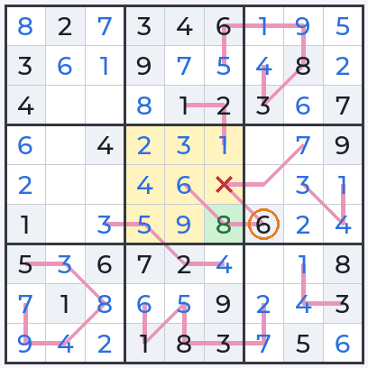

<!-- Written by tools/walkthrough.py zipper-lines: edit the script, not this page. -->
# Zipper Lines, step 43: the 8 in box 5

**Step 43 of 53** · [← Step 42](step-42.md) · [All steps](../zipper-lines.md#the-whole-puzzle-step-by-step) · [Step 44 →](step-44.md)

Box 5 needs an 8. r5c6: it pairs with the 6 in r6c7 on its pink line, whose pairs add up to 13: it's 7. Only **r6c6** is left: **r6c6 = 8**.

**Step 43 of 53** · [← Step 42](step-42.md) · [All steps](../zipper-lines.md#the-whole-puzzle-step-by-step) · [Step 44 →](step-44.md)
