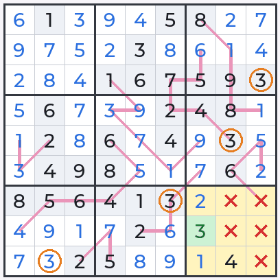

<!-- Written by tools/walkthrough.py zipper-lines: edit the script, not this page. -->
# Zipper Lines, step 44: the 7 in box 5

**Step 44 of 53** · [← Step 43](step-43.md) · [All steps](../zipper-lines.md#the-whole-puzzle-step-by-step) · [Step 45 →](step-45.md)

Box 5 needs a 7, and r5c6 is its last empty cell: **r5c6 = 7**.

**Step 44 of 53** · [← Step 43](step-43.md) · [All steps](../zipper-lines.md#the-whole-puzzle-step-by-step) · [Step 45 →](step-45.md)
