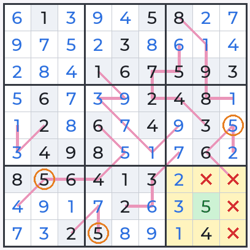

<!-- Written by tools/walkthrough.py zipper-lines: edit the script, not this page. -->
# Zipper Lines, step 45: the 7 in box 4

**Step 45 of 53** · [← Step 44](step-44.md) · [All steps](../zipper-lines.md#the-whole-puzzle-step-by-step) · [Step 46 →](step-46.md)

Box 4 needs a 7. r4c2: row 4 has one (r4c8). r5c2 and r5c3: row 5 has one (r5c6). Only **r6c2** is left: **r6c2 = 7**.

**Step 45 of 53** · [← Step 44](step-44.md) · [All steps](../zipper-lines.md#the-whole-puzzle-step-by-step) · [Step 46 →](step-46.md)
