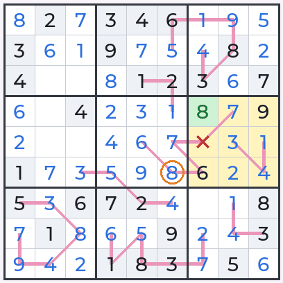

<!-- Written by tools/walkthrough.py zipper-lines: edit the script, not this page. -->
# Zipper Lines, step 46: the 8 in box 6

**Step 46 of 53** · [← Step 45](step-45.md) · [All steps](../zipper-lines.md#the-whole-puzzle-step-by-step) · [Step 47 →](step-47.md)

Box 6 needs an 8. r5c7: it pairs with the 8 in r6c6 on its pink line, whose pairs add up to 13: it's 5. Only **r4c7** is left: **r4c7 = 8**.

**Step 46 of 53** · [← Step 45](step-45.md) · [All steps](../zipper-lines.md#the-whole-puzzle-step-by-step) · [Step 47 →](step-47.md)
