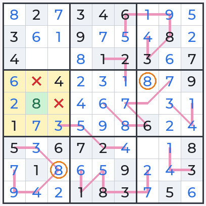

<!-- Written by tools/walkthrough.py zipper-lines: edit the script, not this page. -->
# Zipper Lines, step 47: the 8 in box 4

**Step 47 of 53** · [← Step 46](step-46.md) · [All steps](../zipper-lines.md#the-whole-puzzle-step-by-step) · [Step 48 →](step-48.md)

Box 4 needs an 8. r4c2: row 4 has one (r4c7). r5c3: column 3 has one (r8c3). Only **r5c2** is left: **r5c2 = 8**.

**Step 47 of 53** · [← Step 46](step-46.md) · [All steps](../zipper-lines.md#the-whole-puzzle-step-by-step) · [Step 48 →](step-48.md)
