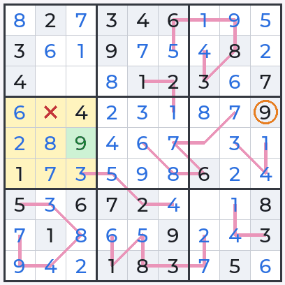

<!-- Written by tools/walkthrough.py zipper-lines: edit the script, not this page. -->
# Zipper Lines, step 48: the 9 in box 4

**Step 48 of 53** · [← Step 47](step-47.md) · [All steps](../zipper-lines.md#the-whole-puzzle-step-by-step) · [Step 49 →](step-49.md)

Box 4 needs a 9. r4c2: row 4 has one (r4c9). Only **r5c3** is left: **r5c3 = 9**.

**Step 48 of 53** · [← Step 47](step-47.md) · [All steps](../zipper-lines.md#the-whole-puzzle-step-by-step) · [Step 49 →](step-49.md)
