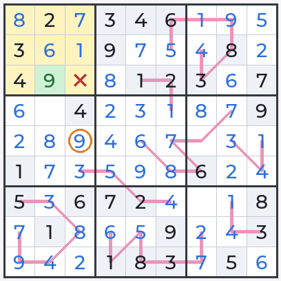

<!-- Written by tools/walkthrough.py zipper-lines: edit the script, not this page. -->
# Zipper Lines, step 49: the 9 in box 1

**Step 49 of 53** · [← Step 48](step-48.md) · [All steps](../zipper-lines.md#the-whole-puzzle-step-by-step) · [Step 50 →](step-50.md)

Box 1 needs a 9. r3c3: column 3 has one (r5c3). Only **r3c2** is left: **r3c2 = 9**.

**Step 49 of 53** · [← Step 48](step-48.md) · [All steps](../zipper-lines.md#the-whole-puzzle-step-by-step) · [Step 50 →](step-50.md)
