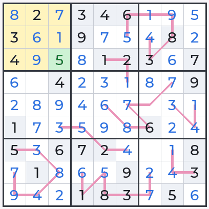

<!-- Written by tools/walkthrough.py zipper-lines: edit the script, not this page. -->
# Zipper Lines, step 50: the 5 in box 1

**Step 50 of 53** · [← Step 49](step-49.md) · [All steps](../zipper-lines.md#the-whole-puzzle-step-by-step) · [Step 51 →](step-51.md)

Box 1 needs a 5, and r3c3 is its last empty cell: **r3c3 = 5**.

**Step 50 of 53** · [← Step 49](step-49.md) · [All steps](../zipper-lines.md#the-whole-puzzle-step-by-step) · [Step 51 →](step-51.md)
