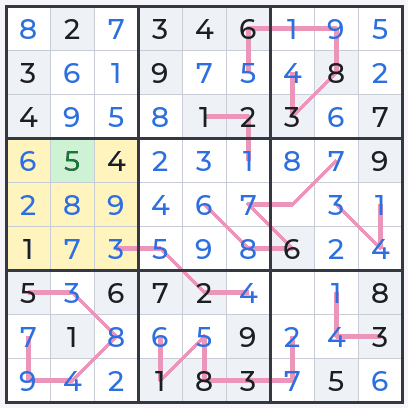

<!-- Written by tools/walkthrough.py zipper-lines: edit the script, not this page. -->
# Zipper Lines, step 51: the 5 in box 4

**Step 51 of 53** · [← Step 50](step-50.md) · [All steps](../zipper-lines.md#the-whole-puzzle-step-by-step) · [Step 52 →](step-52.md)

Box 4 needs a 5, and r4c2 is its last empty cell: **r4c2 = 5**.

**Step 51 of 53** · [← Step 50](step-50.md) · [All steps](../zipper-lines.md#the-whole-puzzle-step-by-step) · [Step 52 →](step-52.md)
