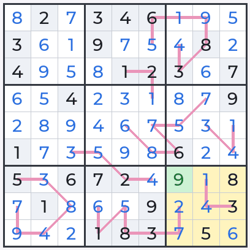

<!-- Written by tools/walkthrough.py zipper-lines: edit the script, not this page. -->
# Zipper Lines, step 53: the 9 in box 9

**Step 53 of 53** · [← Step 52](step-52.md) · [All steps](../zipper-lines.md#the-whole-puzzle-step-by-step) · [All steps](../zipper-lines.md#the-whole-puzzle-step-by-step)

Box 9 needs a 9, and r7c7 is its last empty cell: **r7c7 = 9**.

Solved.

**Step 53 of 53** · [← Step 52](step-52.md) · [All steps](../zipper-lines.md#the-whole-puzzle-step-by-step) · [All steps](../zipper-lines.md#the-whole-puzzle-step-by-step)
